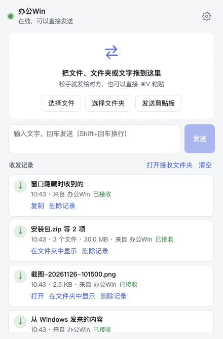

# Win2Mac

在 Windows 和 Mac 之间互传文字、文件、文件夹的桌面小工具。内容经**你自己的服务器**中转，不依赖任何第三方网盘或聊天软件。

Drag-and-drop text, files and folders between Windows and Mac through your own relay server. A tiny always-on-top drop target, a tray icon and a global hotkey on each machine; a single-file, zero-dependency Node relay on your server.

<p>
  
  
</p>

## 功能

- **拖**：把文件、文件夹或选中的文字拖到屏幕上的悬浮球，或拖进主界面，松手就发。
- **点**：主界面里“选择文件”（可多选）、“选择文件夹”（可多选）。
- **贴**：复制之后按全局快捷键（默认 `Ctrl+Alt+S`，Mac 上是 `Control+Option+S`）把剪贴板发出去；
  或者在主界面里直接 `Ctrl/⌘+V`。剪贴板里是文件、文字、截图都可以。
- **打字**：主界面输入框回车发送。

对方收到后：

- 文字自动进剪贴板，直接粘贴即可；截图同时存成文件并放进剪贴板；
- 文件存到 `下载/Win2Mac/`，系统通知点一下定位到文件；记录里的文件可以直接拖出去；
- 文件名经跨平台转换后发生冲突也会自动编号，同名文件变成 `名字 (2).ext`；文件夹保持原有目录结构。

对方不在线也能发：内容暂存在服务器，对方上线后自动收到；所有设备收完即从服务器删除，没人收的默认最多留 7 天。

**对方在线时文件走直连**：两台电脑之间直接打通一条加密通道，文件不经过服务器，速度取决于两边的宽带而不是服务器的带宽；
两边都没有公网 IP 也可以。打不通时自动改走服务器中转，不需要操作。详见下文“[直连](#直连)”。

悬浮球：单击开关主界面，按住拖动换位置，右键出菜单。右下角小点绿色 = 对方在线，黄色 = 对方离线，灰色 = 没连上服务器。

**给 AI 用的远程控制（MCP）**：装了 Win2Mac 的电脑之间，本机的 AI 客户端可以通过它在另一台电脑上执行命令、读写文件、收发文件、读写剪贴板、截图。默认关闭，详见下文“[远程控制（MCP）](#远程控制mcp)”。

配对的设备不限于两台：同一个口令下的所有设备互相可见，发出的内容其他设备都会收到。

## 结构

```
server/server.js     中转服务，Node 单文件零依赖（SSE 推送 + HTTP 分片上传 / 断点下载）
server/deploy/       systemd 单元、nginx 反代片段、环境变量示例
app/                 桌面客户端（Electron）
  src/core.js        传输核心，纯 Node，不依赖 Electron
  src/direct.js      直连：信令、STUN 地址解析、连接与通道管理，纯 Node
  src/p2p.js         直连引擎：隐藏窗口里的 WebRTC（页面在 src/ui/p2p-page.js）
  src/control.js     远程控制：设备密钥、签名验签、被控端执行器、控制端
  src/mcp.js         MCP 服务（stdio），把远程控制包装成 AI 可调用的工具
  src/mcp-register.js  把 MCP 服务登记到本机的 AI 客户端
  src/main.js        主进程：托盘、悬浮窗、快捷键、剪贴板、通知
  src/ui/            主界面与悬浮球页面
test/e2e.js          协议端到端测试
test/direct.js       直连的协议测试（先直连、打不通改走中转、不重复、取消），用内存里的假通道
test/p2p-smoke.js    启动两个真实应用实例，用 WebRTC 互相直连传文件
test/control.js      远程控制与 MCP 的端到端测试（权限分级、伪造、重放、文件收发）
test/mcp-call.js     启动一个 MCP 进程并调用工具，验证已安装的程序
test/smoke.js        启动真实应用的冒烟测试（模拟拖放、剪贴板、双向收发）
test/live.js         对着已部署的服务互传一次并测速
test/probe.js        用临时设备向所有已配对设备发文件，验证真实安装
```

## 部署中转服务

需要一台有公网 HTTPS 入口的 Linux 服务器，装有 Node 18+ 和 nginx。

```bash
# 1. 独立的低权限用户和目录
useradd --system --no-create-home --shell /sbin/nologin win2mac
install -d -m 755 /opt/win2mac /etc/win2mac
install -d -m 750 -o win2mac -g win2mac /var/lib/win2mac

# 2. 程序、配置、服务单元
install -m 644 server/server.js /opt/win2mac/server.js
install -m 600 server/deploy/relay.env.example /etc/win2mac/relay.env
install -m 644 server/deploy/win2mac-relay.service /etc/systemd/system/

# 3. 生成口令，填进 /etc/win2mac/relay.env 的 W2M_TOKEN=
openssl rand -hex 32

# 4. 启动
systemctl daemon-reload
systemctl enable --now win2mac-relay
```

服务只监听本机回环地址（默认 `127.0.0.1:18700`），再用 nginx 把它挂到一个 HTTPS 地址下。
`server/deploy/nginx-location.conf` 是一个可以直接 `include` 进现有 `server {}` 的片段（默认子路径 `/w2m/`）：

```nginx
server {
    # ……你已有的 HTTPS 站点配置……
    include /etc/win2mac/nginx-location.conf;
}
```

`nginx -t && systemctl reload nginx` 之后验证：

```bash
curl -H "Authorization: Bearer <口令>" https://你的域名/w2m/api/ping   # {"ok":true,...}
curl https://你的域名/w2m/api/ping                                     # 401
```

可调的环境变量见 `server/deploy/relay.env.example`（端口、数据目录、保留天数、暂存空间上限）。

## 安装客户端

```bash
cd app
npm install
npm start            # 开发运行
npm run dist:mac     # 产出 dist/*.dmg（arm64）
npm run dist:win     # 产出 dist/*.exe 安装包（x64，可以在 Mac 上交叉打包，不需要 wine）
npm run icons        # 重新生成图标
```

第一台设备：打开设置，填入服务器地址（例如 `https://你的域名/w2m`）和口令，保存。
其余设备：在已配好的设备上点“设置 → 复制配对码”，到新设备的设置里粘贴并应用即可。
配对码里包含服务器地址和口令，等同于口令本身，不要外传。

从旧版升级时，先更新中转服务，再更新两台设备的客户端，各启动一次。首次启动会把原设备签名私钥迁入 macOS 钥匙串或 Windows 凭据管理器，原指纹和授权继续有效。定向传文件要求两端均支持 SHA-256 校验；显示拒收回执需要中转和两端客户端均已升级。

换机或重装后留下的旧设备，可以在“设置 → 其他设备”里移除，否则发给它的内容要等过期才会从服务器清掉。

## 直连

两台电脑都在线时，文件（256KB 以上）不再上传到服务器，而是在两台电脑之间直接传：

```
发送方 ──经中转交换连接信息（几百字节）──▶ 接收方
发送方 ◀════ 打通后的加密通道，文件走这里 ════▶ 接收方
```

- **不需要公网 IP，也不用配路由器**。两边各自向外发包，在各自的路由器上“打洞”，中转服务器只当介绍人。
  在同一个局域网里时走的就是内网。
- **打不通就走中转**。有些网络（管得严的公司网、部分移动网络）打不通，这时自动改走服务器，和以前一样。
  传到一半断了也会改走中转重传。中转和两端客户端都支持批次回执时会启用直连，混用旧版时自动通过中转发送。
  接收端会保存每批文件的送达或拒收结果。文件已接收但最后一条回执丢失时，重启后也只补回执。再次主动发送会创建新批次。
  如果应用恰在把暂存文件发布到接收目录期间异常退出，重投时会提示核对接收目录，以免重复保存或误报送达。
- **每次连接现查地址**，换 WiFi、换网络不用做任何设置。没打通的话过一分钟再试，接连失败会越隔越久（最长半小时），
  任何一方换了网络重新上线就从头算。
- **对方离线时照旧暂存到服务器**。设备多于两台时，在线的直连收，离线的上线后从服务器收，各收一份。
- 文字和小文件仍走中转，省得为一张截图去打洞。
- 连接空闲 5 分钟后断开，下次要传时重新建立，大约一两秒。

通道用的是 Electron 自带的 WebRTC：DTLS 加密，直连的内容服务器看不到。交换连接信息时用设备密钥签名，
对方是本机在“远程控制”里授权过的设备时，按授权时核对过的那把公钥验签。

查询“我在公网上的地址”要用到 STUN 服务器，默认用几个公共的（小米、哔哩哔哩、Cloudflare），
它们只会看到你的 IP，看不到任何内容。想换成自己的，在配置文件 `config.json` 里加
`"stun": ["服务器一:3478", "服务器二:3478"]`。顺序有讲究：排最前的两个是主参照，
一块网卡只有从它俩查到的公网地址一致才会被用来打洞，所以要选和你的设备在同一个地区的
（默认的前两个在中国大陆，在别的地区使用请换掉）。不想用直连，在设置里取消“对方在线时文件优先直连”即可。

电脑同时连着几条网络、或者开着代理时也能用，Win2Mac 会挑能打洞的那条：

- 代理软件的虚拟网卡（TUN 模式）会把域名解析成假地址，Win2Mac 绕开它，从真实网卡的出口去打洞；
- 按目的地换端口的网络（对称型 NAT，常见于手机热点和移动网络）打不了洞，这条网络的公网地址不用；
- 国内外分流的网络，从国外服务器查到的可能是绕远路的出口，连得上但很慢，也不用。

连上以后如果传不动（30 秒内确认不到 1MB），这一次改走中转，这条连接断开，过一阵再试。

目前的限制：AI 经 MCP 收发文件（`copy_file_to_device` / `copy_file_from_device`）还是走中转；直连没有断点续传。

## 远程控制（MCP）

让一台电脑上的 AI（Claude、Codex、Cursor、opencode 等任何支持 MCP 的客户端）操作另一台装了 Win2Mac 的电脑，
不需要 SSH、隧道，也不用每次向 AI 交代“那台机器怎么连、是什么系统”。

```
AI 客户端 ──stdio──▶ 本机的 Win2Mac MCP 进程 ──▶ 中转服务 ──▶ 对方电脑上运行着的 Win2Mac ──▶ 执行并返回
```

### 开启

1. **在被控的电脑上授权**：Win2Mac 设置 → 远程控制，给发起控制的那台设备选“只读”或“完全控制”。
   授权前核对列表里显示的指纹，和对方设置里的“本机指纹”一致。默认是“不允许”。
2. **在发起控制的电脑上接入 AI 客户端**：设置 → 远程控制 → “接入本机的 AI 客户端”，会自动登记到本机装了的
   Kimi Code、ZCode、Codex、Claude 桌面版（只新增或更新名为 `win2mac` 的一项，改前留备份）。命令行等价做法：

   ```bash
   ELECTRON_RUN_AS_NODE=1 /Applications/Win2Mac.app/Contents/MacOS/Win2Mac \
     /Applications/Win2Mac.app/Contents/Resources/app.asar/src/mcp-register.js          # 加 --remove 取消登记
   ```

   Claude Code 用它自己的命令登记：`claude mcp add-json --scope user win2mac '<下面 win2mac 那一项的 JSON>'`。
   其他客户端用“复制 MCP 配置”手动粘贴。配置长这样，用的是 Win2Mac 自带的运行时，不需要另装 Node：

```json
{
  "mcpServers": {
    "win2mac": {
      "command": "/Applications/Win2Mac.app/Contents/MacOS/Win2Mac",
      "args": ["/Applications/Win2Mac.app/Contents/Resources/app.asar/src/mcp.js"],
      "env": { "ELECTRON_RUN_AS_NODE": "1" }
    }
  }
}
```

### 提供的工具

| 工具 | 作用 | 需要的权限 |
|---|---|---|
| `list_devices` | 列出其他设备：是否在线、系统、主目录、用什么 shell | 只读 |
| `run_command` | 执行命令，返回输出和退出码（带超时，超长输出保留头尾） | 完全控制 |
| `list_directory` / `read_file` | 列目录、读文本文件 | 只读 |
| `write_file` | 写或追加文本文件 | 完全控制 |
| `copy_file_to_device` | 把本机文件传到对方指定位置，大小不限 | 完全控制 |
| `copy_file_from_device` | 把对方的文件取到本机，大小不限 | 只读 |
| `get_clipboard` / `take_screenshot` | 读剪贴板、截屏 | 只读 |
| `set_clipboard` / `open_on_device` | 写剪贴板、用默认程序打开文件或网址 | 完全控制 |

命令在对方的**桌面会话**里以当前登录用户身份运行，所以能启动图形程序、能截图。
Windows 上用系统自带的 PowerShell 执行，输出统一成 UTF-8，不加载用户 profile；macOS 上用登录 shell。

### 安全模型

远程执行比传文件危险得多，所以这部分**不信任中转服务器**：

- 每台设备有自己的 Ed25519 密钥，私钥只留在本机。请求由发起方签名，被控方只执行“本机用户授权过的那把公钥”签出的请求；
  应答由被控方签名，发起方按首次见到并记下的公钥验签，公钥变了会报错而不是默默接受。
- 所以只拿到中转口令、或者攻破中转服务器，都**不能**让任何一台设备执行命令；改内容、重放旧请求、过期请求都会被拒绝。
- 定向文件的 SHA-256 摘要随请求或应答一起签名，接收方在发布文件前校验。远程文件读取和取回会检查真实路径，保护 Win2Mac 应用数据目录和设备凭据。
- 每台设备单独授权，分“只读”和“完全控制”两档，默认不允许。
- 被远程操作时悬浮球会闪橙色；每次操作（包括被拒绝的）都记在本机的 `control.log` 里，设置页能看到最近几条。
- 请求和结果经中转时是明文（外层有 HTTPS），中转能看到内容但伪造不了。
- **给 AI 客户端的建议**：`run_command`、`write_file` 这类会改动对方电脑的工具保留人工确认，不要设成自动放行——
  AI 读到不可信内容时，可能被诱导去对另一台电脑下命令。

### 限制

- 对方电脑要开着、已登录、Win2Mac 在运行；不在线时直接报错，不会排队等它上线再执行。
- macOS 上截图需要给 Win2Mac“录屏”权限（系统设置 → 隐私与安全性）；第一次被请求截图时系统会弹出询问。
- macOS 上第一次执行命令可能很慢甚至卡住：如果你的 shell 启动脚本会访问外置盘、“文稿”等受保护的位置，系统会弹出权限询问，在那台 Mac 上点一下之后就正常了。
- 没有正式签名的自行打包版本，每次重装后 macOS 会把这些权限当成新程序重新询问。
- 一次只传单个文件，文件夹请先打包；鼠标键盘级别的界面操控还没有做。
- Windows 上个别老程序（如 `hostname.exe`）会无视编码设置输出 GBK，显示成乱码；换用 PowerShell 自己的写法（如 `$env:COMPUTERNAME`）即可。
- 如果某个客户端不支持给 MCP 进程传环境变量，直接用 `Win2Mac 可执行文件 + mcp.js 路径` 启动也可以，只是启动稍慢。
- 中转服务需要是带 `/api/rpc` 的版本，旧部署要先更新 `server.js`。

## 测试

```bash
cd app && npm ci && cd ..                         # 安装桌面端和测试依赖
node --test test/identity.js test/register.js test/transfer-regression.js test/direct-hub.js test/p2p-engine.js
node test/e2e.js                                  # 协议测试，本地起一个临时服务
node test/direct.js                               # 直连的协议测试
node test/p2p-smoke.js                            # 两个真实应用实例之间的 WebRTC 直连，会启动两个不显示窗口的实例
node test/control.js                              # 远程控制与 MCP 测试
cd app && npx electron ../test/smoke.js ./shots   # 启动真实应用，会短暂占用剪贴板并弹出窗口
```

`test/live.js` 和 `test/probe.js` 是对着真实部署跑的，会向**所有在线的已配对设备**发送测试内容。

## 速度

对方在线并且直连打通时，速度取决于两边的宽带，和服务器无关。

走中转时，上传走的是你到服务器的上行，下载走的是服务器的出口带宽，通常后者是瓶颈。
小带宽的云服务器上，文字、截图、文档基本无感，大文件接收会比较慢。

## 安全说明

- 远程控制另有一层设备密钥签名，见上文“安全模型”。
- 所有接口都要带口令（Bearer token），口令比较使用定长哈希后的常量时间比较；外面应当套 HTTPS。
- 走中转的内容在服务器上是**明文暂存**的，没有做端到端加密——请只部署在你信任的服务器上。
  走直连的文件不经过服务器。
- 服务以独立低权限用户运行，systemd 单元里限制了它只能写自己的数据目录。
- 客户端渲染进程开启了上下文隔离和 CSP，收到的文字一律按纯文本显示。

## License

[MIT](LICENSE)
