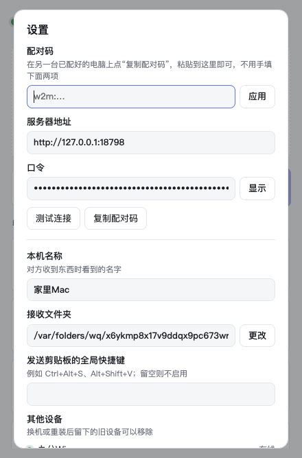

# Win2Mac

在 Windows 和 Mac 之间互传文字、文件、文件夹的桌面小工具。内容经**你自己的服务器**中转，不依赖任何第三方网盘或聊天软件。

Drag-and-drop text, files and folders between Windows and Mac through your own relay server. A tiny always-on-top drop target, a tray icon and a global hotkey on each machine; a single-file, zero-dependency Node relay on your server.

<p>
  
  
</p>

## 功能

- **拖**：把文件、文件夹或选中的文字拖到屏幕上的悬浮球，或拖进主界面，松手就发。
- **点**：主界面里“选择文件”（可多选）、“选择文件夹”（可多选）。
- **贴**：复制之后按全局快捷键（默认 `Ctrl+Alt+S`，Mac 上是 `Control+Option+S`）把剪贴板发出去；
  或者在主界面里直接 `Ctrl/⌘+V`。剪贴板里是文件、文字、截图都可以。
- **打字**：主界面输入框回车发送。

对方收到后：

- 文字自动进剪贴板，直接粘贴即可；截图同时存成文件并放进剪贴板；
- 文件存到 `下载/Win2Mac/`，系统通知点一下定位到文件；记录里的文件可以直接拖出去；
- 同名文件不覆盖，自动变成 `名字 (2).ext`；文件夹保持原有目录结构。

对方不在线也能发：内容暂存在服务器，对方上线后自动收到；所有设备收完即从服务器删除，没人收的默认最多留 7 天。

悬浮球：单击开关主界面，按住拖动换位置，右键出菜单。右下角小点绿色 = 对方在线，黄色 = 对方离线，灰色 = 没连上服务器。

配对的设备不限于两台：同一个口令下的所有设备互相可见，发出的内容其他设备都会收到。

## 结构

```
server/server.js     中转服务，Node 单文件零依赖（SSE 推送 + HTTP 分片上传 / 断点下载）
server/deploy/       systemd 单元、nginx 反代片段、环境变量示例
app/                 桌面客户端（Electron）
  src/core.js        传输核心，纯 Node，不依赖 Electron
  src/main.js        主进程：托盘、悬浮窗、快捷键、剪贴板、通知
  src/ui/            主界面与悬浮球页面
test/e2e.js          协议端到端测试
test/smoke.js        启动真实应用的冒烟测试（模拟拖放、剪贴板、双向收发）
test/live.js         对着已部署的服务互传一次并测速
test/probe.js        用临时设备向所有已配对设备发文件，验证真实安装
```

## 部署中转服务

需要一台有公网 HTTPS 入口的 Linux 服务器，装有 Node 18+ 和 nginx。

```bash
# 1. 独立的低权限用户和目录
useradd --system --no-create-home --shell /sbin/nologin win2mac
install -d -m 755 /opt/win2mac /etc/win2mac
install -d -m 750 -o win2mac -g win2mac /var/lib/win2mac

# 2. 程序、配置、服务单元
install -m 644 server/server.js /opt/win2mac/server.js
install -m 600 server/deploy/relay.env.example /etc/win2mac/relay.env
install -m 644 server/deploy/win2mac-relay.service /etc/systemd/system/

# 3. 生成口令，填进 /etc/win2mac/relay.env 的 W2M_TOKEN=
openssl rand -hex 32

# 4. 启动
systemctl daemon-reload
systemctl enable --now win2mac-relay
```

服务只监听本机回环地址（默认 `127.0.0.1:18700`），再用 nginx 把它挂到一个 HTTPS 地址下。
`server/deploy/nginx-location.conf` 是一个可以直接 `include` 进现有 `server {}` 的片段（默认子路径 `/w2m/`）：

```nginx
server {
    # ……你已有的 HTTPS 站点配置……
    include /etc/win2mac/nginx-location.conf;
}
```

`nginx -t && systemctl reload nginx` 之后验证：

```bash
curl -H "Authorization: Bearer <口令>" https://你的域名/w2m/api/ping   # {"ok":true,...}
curl https://你的域名/w2m/api/ping                                     # 401
```

可调的环境变量见 `server/deploy/relay.env.example`（端口、数据目录、保留天数、暂存空间上限）。

## 安装客户端

```bash
cd app
npm install
npm start            # 开发运行
npm run dist:mac     # 产出 dist/*.dmg（arm64）
npm run dist:win     # 产出 dist/*.exe 安装包（x64，可以在 Mac 上交叉打包，不需要 wine）
npm run icons        # 重新生成图标
```

第一台设备：打开设置，填入服务器地址（例如 `https://你的域名/w2m`）和口令，保存。
其余设备：在已配好的设备上点“设置 → 复制配对码”，到新设备的设置里粘贴并应用即可。
配对码里包含服务器地址和口令，等同于口令本身，不要外传。

换机或重装后留下的旧设备，可以在“设置 → 其他设备”里移除，否则发给它的内容要等过期才会从服务器清掉。

## 测试

```bash
node test/e2e.js                                  # 协议测试，本地起一个临时服务
cd app && npx electron ../test/smoke.js ./shots   # 启动真实应用，会短暂占用剪贴板并弹出窗口
```

`test/live.js` 和 `test/probe.js` 是对着真实部署跑的，会向**所有在线的已配对设备**发送测试内容。

## 速度

上传走的是你到服务器的上行，下载走的是服务器的出口带宽，通常后者是瓶颈。
小带宽的云服务器上，文字、截图、文档基本无感，大文件接收会比较慢。

## 安全说明

- 所有接口都要带口令（Bearer token），口令比较使用定长哈希后的常量时间比较；外面应当套 HTTPS。
- 内容在服务器上是**明文暂存**的，没有做端到端加密——请只部署在你信任的服务器上。
- 服务以独立低权限用户运行，systemd 单元里限制了它只能写自己的数据目录。
- 客户端渲染进程开启了上下文隔离和 CSP，收到的文字一律按纯文本显示。

## License

[MIT](LICENSE)
